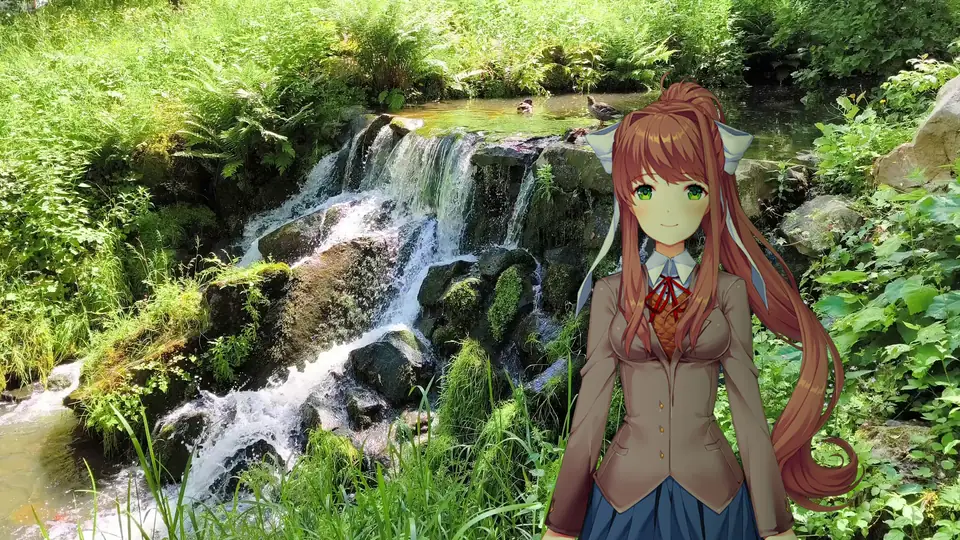

# SceneLight for Ren’Py

Automatic character lighting for Ren’Py. Sprites respond to the background’s
light and color as they move through a scene.

> **Before you start:** Back up your game or project folder and saves. You’ll have an easy way back if setup is interrupted or your game isn’t compatible.

**[Windows downloads](https://github.com/RageAdo-dev/SceneLight/releases)** · [Installation guide](docs/INSTALL.md) · [Author guide](docs/AUTHOR_QUICKSTART.md)

## Installation

1. Download the small `Windows-online.zip`, extract it and open **SceneLight.exe**. It downloads and verifies the required components once. For a computer without internet, choose the full `Windows.zip` instead.
2. Select your game folder and review the detected characters.
3. Choose **Add to this game** or **Create separate copy**, then let setup finish.

Launch the game normally. Videos are prepared once during setup for faster playback.
The online and offline options install the same tested build. The online installer
shows the download size before starting; it reduces the initial file size, not the
total data required. No system Python installation is needed.
For private beta releases, use the complete **Windows.zip**. The small online
installer is for publicly downloadable releases and does not sign in to GitHub.

## Example scenes

Monika in a sunlit forest, rendered with SceneLight’s default settings.

Compare without SceneLight

The same character with a moving background:

[Video](docs/media/waterfall-example.mp4) · [GIF](docs/media/waterfall-example.gif) · [full-quality
downloads](https://github.com/RageAdo-dev/SceneLight/releases/tag/v1.0.0-beta)

Monika © Team Salvato. These are unofficial examples. [Artwork and background credits](docs/media/CREDITS.md).

## Preview & Calibrator

Load a background and sprite, move the character, and adjust the lighting.
Open it from **Settings → Tools → Open Preview & Calibrator**.

[Video](docs/media/moving-light.mp4) · [GIF](docs/media/moving-light.gif) · [full-quality
downloads](https://github.com/RageAdo-dev/SceneLight/releases/tag/v1.0.0-beta)

## Surface maps

SceneLight generates height, normal and occlusion maps from your sprites to give
the lighting shape and detail.

[How it works →](docs/HOW_IT_WORKS.md)

## For game creators

Choose **For mod developers → Install developer API** in Setup. Your existing
`scene`, `show`, ATL and transitions continue to work.

[Author guide](docs/AUTHOR_QUICKSTART.md) · [API reference](docs/MOD_AUTHOR_API.md)

## Requirements

Windows and compatible graphics. A dedicated GPU is not required. Supports
Ren’Py 7 and 8, with a compatibility runtime for some older games.
[Compatibility details](docs/BETA_VALIDATION.md).

[Documentation](docs/README.md) · [MIT license](LICENSE) · [Contributing](CONTRIBUTING.md) · [Third-party notices](THIRD_PARTY_NOTICES.md)

Eileen by Piroshki, from the Ren’Py tutorial. [Credits](docs/media/CREDITS.md).
