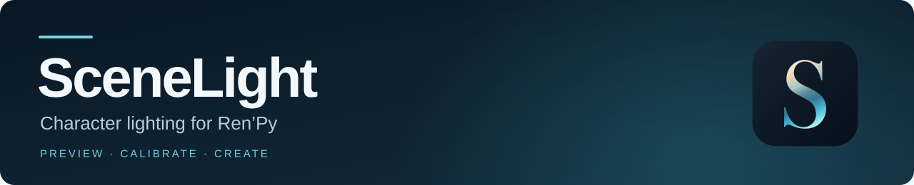
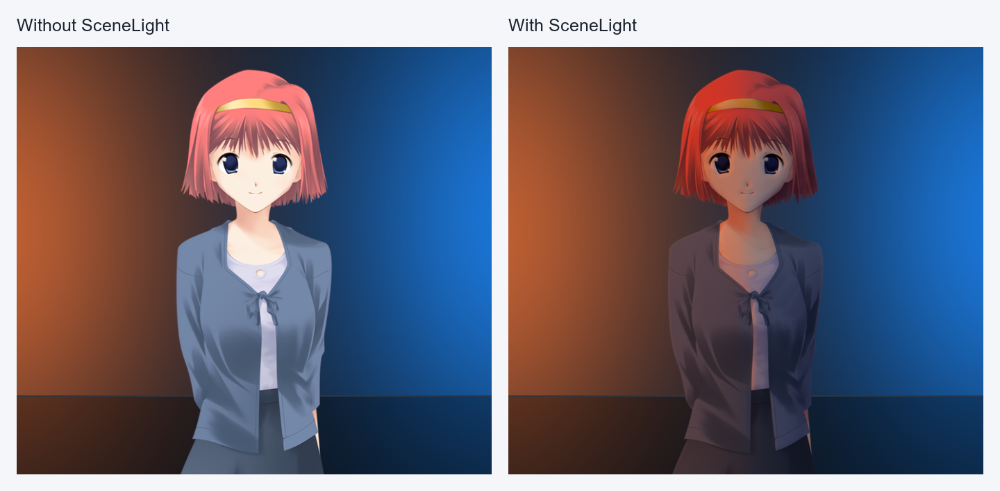
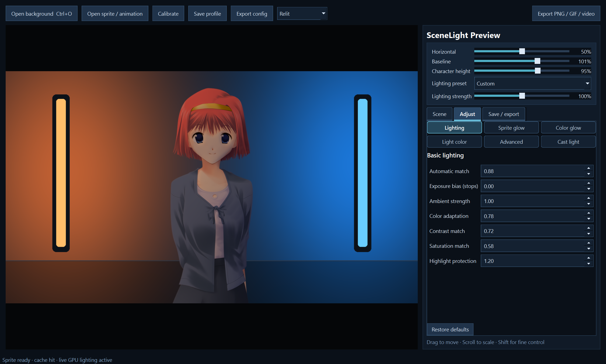
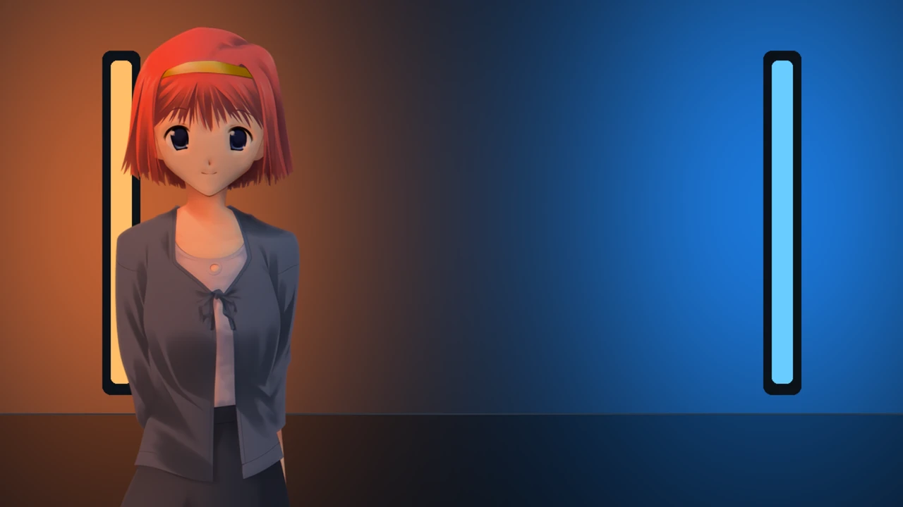

Match your characters to the light around them.

**[Download for Windows](https://github.com/RageAdo-dev/SceneLight/releases/tag/v1.1.1)** · **[Install](docs/INSTALL.md)** · **[Mod developer guide](docs/AUTHOR_QUICKSTART.md)**

[Ren’Py 7 & 8](docs/COMPATIBILITY.md) · [Version 1.1.1](CHANGELOG.md) · [MIT license](LICENSE)

SceneLight adds background lighting to Ren’Py sprites. Characters respond to nearby
colors and light sources as they move, with controls for shadows, highlights and glow.

## Get started

1. Download **SceneLight-v1.1.1-Windows.zip**, extract it, and open **SceneLight.exe**.
2. Select your game folder, scan it, and choose the characters to light.
3. Install, wait for completion, and launch the game.

Players can add SceneLight to a game or create a separate copy. Mod developers can
install the API in their project and control lighting from their scripts.
The Windows package includes everything needed to start; no Python setup is required.

## Preview and controls

| Tool | What you can do |
| --- | --- |
| [Preview & Calibrator](docs/PREVIEW_WORKSPACE.md) | Move a sprite, tune lighting and glow, and compare with the original. Review settings before saving, or export an image or video. |
| [In-game inspector](docs/TROUBLESHOOTING.md) | Press **Shift+F9** to see the applied settings, try temporary changes, and export a bug report. |
| [Mod API](docs/AUTHOR_QUICKSTART.md) | Set rules for backgrounds, characters and expressions. Group separate sprite pieces so they share lighting. |

Setup detects project edits while it stays open. Choose **Check changed assets →
Update SceneLight**, then restart the game. Updates reuse compatible prepared data.

## Example

[Watch the video](docs/media/moving-light.mp4) · [More examples](docs/GALLERY.md)

## Requirements and help

The Windows app supports compatible Ren’Py 7 and 8 games and includes a runtime for
some older games. Working graphics acceleration is required; CUDA is optional.
See [compatibility](docs/COMPATIBILITY.md) for hardware requirements and limitations.

[Documentation](docs/README.md) · [Troubleshooting](docs/TROUBLESHOOTING.md) · [Changelog](CHANGELOG.md)

---

[Contributing](CONTRIBUTING.md) · [Security](SECURITY.md) · [Third-party notices](THIRD_PARTY_NOTICES.md)

Eileen artwork by Piroshki, from the Ren’Py tutorial. [Artwork credits and licenses](docs/media/CREDITS.md).
