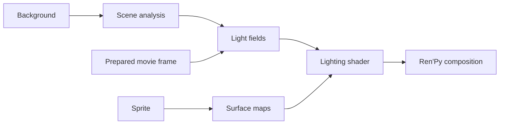

# Architecture

SceneLight separates reusable sprite geometry from lighting that depends on the
background. Preview and Ren'Py use the same scene analyzer and lighting shader.

## Main modules

| Module | Responsibility |
| --- | --- |
| `setup_gui.py` | Installation, character review, components and updates |
| `desktop.py` | Windows EXE entry point and bundled runtime selection |
| `project.py`, `capture.py` | Source discovery and renderer-backed asset capture |
| `engine.py`, `form_maps.py` | CPU reference analysis and sprite surface reconstruction |
| `builder.py`, `cuda_backend.py` | Installation data, offline transport and optional CUDA acceleration |
| `prepared.py` | Per-frame movie preparation |
| `runtime/live_gpu.py` | Shared live GPU analysis |
| `runtime/live_renpy.py`, `runtime/prepared_renpy.py` | Ren'Py background bindings and movie-frame selection |
| `runtime/scenelight_runtime.rpy` | Displayables, lighting shader, author API and effects |
| `runtime/shader_stages.py`, `runtime/shader_renpy.py` | Vertex-sampling optimization and renderer capability checks |
| `preview/` | Qt host, media decoding, calibration and export |

Module paths are relative to `src/scenelight/`.

## Installation and ownership

**Create separate copy** copies authored game files under
`%LOCALAPPDATA%\SceneLight\projects`. A separate analysis cache retains work whose
source fingerprints and algorithm versions still match. The selected source
folder is unchanged; saves created in the managed game are preserved during sync.

**Add to this game** and developer embedding install an owned runtime namespace
and a project-relative hash manifest. Updates validate ownership, build in a
working copy, then swap the completed runtime into place. Failed swaps restore
the previous runtime. Removal checks every owned path and refuses unexpected or
modified files. Legacy launcher replacement keeps a verified original backup.

Capture prefers the game's compatible native renderer. A matching SDK or the
verified legacy compatibility runtime is used where needed. Gameplay uses the
normal game executable, which may delegate to that compatibility runtime.

## Discovery and capture

The static scanner reads ordinary declarations. Renderer-backed discovery resolves
archive-only images, LayeredImages and other dynamic declarations in an isolated
working copy. It captures raw character forms, not final lit frames. A working
copy protects source files from normal analysis writes; it is not a security
sandbox for game code.

Large captures use isolated workers with separate writable state and bounded
concurrency. Completed forms are journaled by image tag and normalized attribute
set so interrupted workers can resume. Plan, pixel and protocol versions are
separate contracts; changing progress text does not invalidate captured pixels.
The capture plan keeps stable batch membership if available worker concurrency
changes on restart. Successful batches are published atomically and validated
before reuse, including surface-normalization markers and composite dependencies.
Clean memory-saving batches do not consume the bounded crash-retry allowance.
Every planned form must have either captured pixels or an explicit per-asset
failure. Missing/unsupported images and unreadable capture inputs are retained as
skips, including whole skipped batches; they do not invalidate healthy work.
The content signature changes when missing artwork is supplied, so an old skip
cannot hide a repaired asset. Unknown worker omissions and output-write failures
remain blocking errors. Skip details are recorded as Activity warnings and as
text evidence in its support export.
An unresolved error pauses capture with usable checkpoints retained; retry the
same project to continue. Changed source content invalidates obsolete captures.

## Surface maps

`form_maps.py` reconstructs height from the silhouette and painted shading.
Form-map version 9 expresses slopes in normalized surface coordinates so larger
sprites do not become flatter. Painted shading is read at form scale, so the
artist's own band and line boundaries do not become creases through a face or a
sleeve, while broad painted volume still shapes the surface. The original color
image remains the material input. Installed game maps and Preview both use the
source resolution and the same reconstruction algorithm. Updating an older
installation regenerates its reduced-resolution maps. Worker concurrency is
bounded by available memory and sprite dimensions rather than reducing map detail.

The two surface textures and the response texture use these RGB channels:

| File | R | G | B |
| --- | --- | --- | --- |
| `normal_noise.png` | Normal X | Normal Y | Edge weight |
| `height_ao_edge.png` | Encoded height | Occlusion amount | Grain |
| `response.png` | Mean light response | Material-weighted response | Mean visibility |

The 64×64 response texture supplies the normalization that would otherwise require
a reduction over the sprite during rendering. Updates rebuild maps when their
version or source changes.

## Scene analysis and prepared playback

The live analyzer measures brightness, contrast, source components, colored-light
families, exposure, probes, emitter fields and environment wrap. Compute shaders
accelerate supported stages; a raster implementation remains available. Capability
checks validate the required float rendering operations before activation.

Transport uses 26 planes over a 16×9 placement grid. Live transport also carries a
metadata row. Four overlapping spatial regions integrate the source field with
weights that sum to one per pixel. Their identities remain fixed when bright
regions split, merge or exchange brightness.
The secondary slots blend continuously between physical lights and colored-light
families. Plane 2 stores square-root-encoded target brightness in red, the blend
in green and a 191/255 format marker in blue. This retains dark-scene precision.
The shader also accepts older linear fields. Texture and varying counts are unchanged.
See [light continuity](live-continuity.md).

With the default `scene_analysis: live`, supported movies are prepared frame by
frame into lossless `.slframes` archives. Playback selects the result matching the
visible decoded frame. Transformed, ambiguous or procedural backgrounds use live
analysis. `scene_analysis: cached` retains the offline timeline path for older
renderers. See [prepared playback](prepared-playback.md).

## Rendering and state

Ren'Py supplies the actual background render after its transforms and placement.
Each showing has a binding; frozen transition sides retain their completed fields.
GPU resources stay outside save and rollback data and are rebuilt after restoration.
Analysis workspaces and shader programs are shared, while completed field textures
have explicit owners.

The character shader combines scene fields, surface maps and calibration at the
final screen position. Movement changes uniforms and sampling positions without
reconstructing the sprite. On compatible drivers, constant scene samples are read
in the vertex stage. Unsupported limits, shader rejection or a custom shader-part
filter select the original path.

Authored `mesh True` transforms remain separate rendering passes. An outer
`show ... at` shader receives the lit character; an effect inside an image
declaration is part of the input to SceneLight. Transition snapshots are retained
on the GPU rather than encoded as screenshots.

Preview compiles the production shader in Qt's OpenGL context. It offers Original,
Relit and Split views; Ren'Py uses Relit. Media decoding runs on a bounded worker
queue. Moving a character does not invoke decoding or scene/form analysis.

## Controls and effects

Calibration and independent lighting strength are stored in versioned profiles.
Author rules apply in this order: defaults, background, scene, character, image.
The scene-level off switch is a hard bypass. Rule state participates in save/load
and rollback; graphics resources do not.

Built-in rain and glitch are optional post-lighting branches. Developer effect
packs add validated shader parts; the player effects panel and hotkey are disabled.
See the [lighting API](MOD_AUTHOR_API.md) and [effect-pack reference](EFFECT_PACKS.md).

[Performance](performance.md) · [Validation](BETA_VALIDATION.md) · [Design history](history/README.md)

## Progress for long operations

Every potentially long installation step must announce its stage before starting.
Use `ProgressStage` for worker shutdown, serialization, copying, hashing, and
cleanup. Report measured item completion when a total is known. Otherwise show an
indeterminate activity indicator and elapsed time; never infer completion from a
heartbeat or leave a prior phase's 100% on screen. The setup UI updates elapsed
time independently of worker output, and Activity retains each stage transition.
Heartbeats repeat the last measured count rather than claiming new work occurred.

Progress output is throttled for large inventories. File operations keep their
existing metadata, ignore rules, verification, and transactional rollback behavior.
Future stages must be registered in `progress.STAGE_LABELS` and covered by parser,
slow-operation, and failure-path checks.
