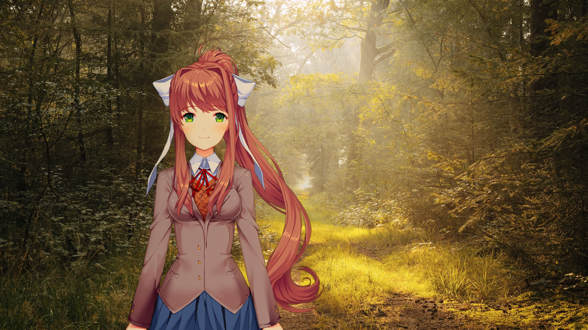
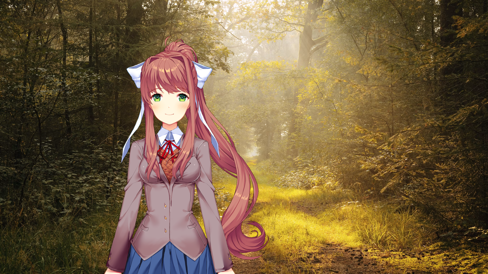
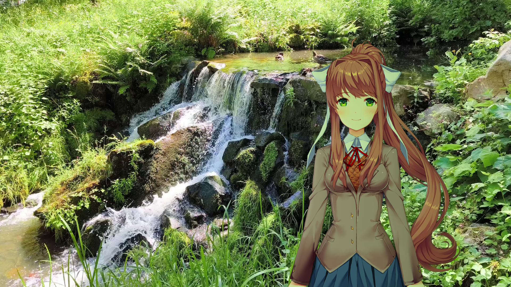
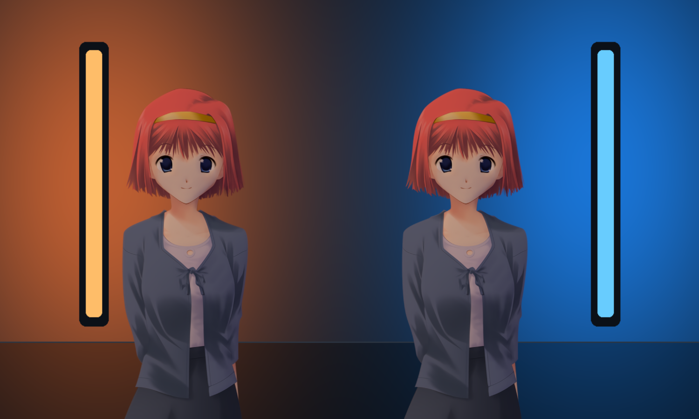
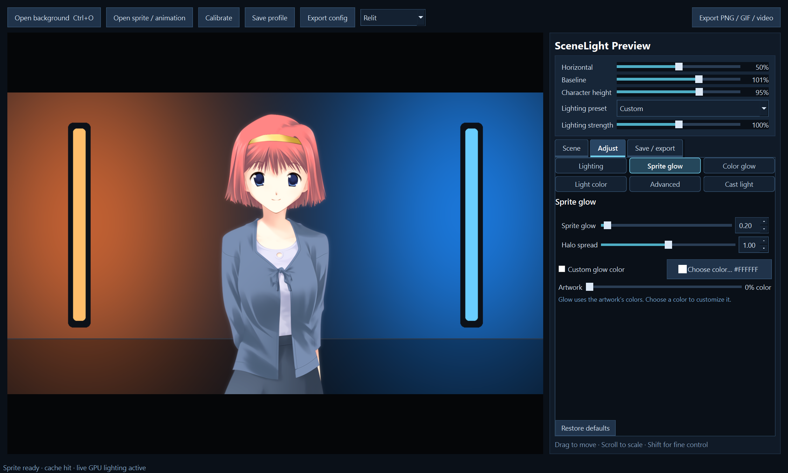
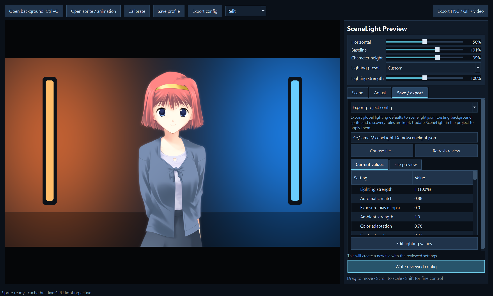
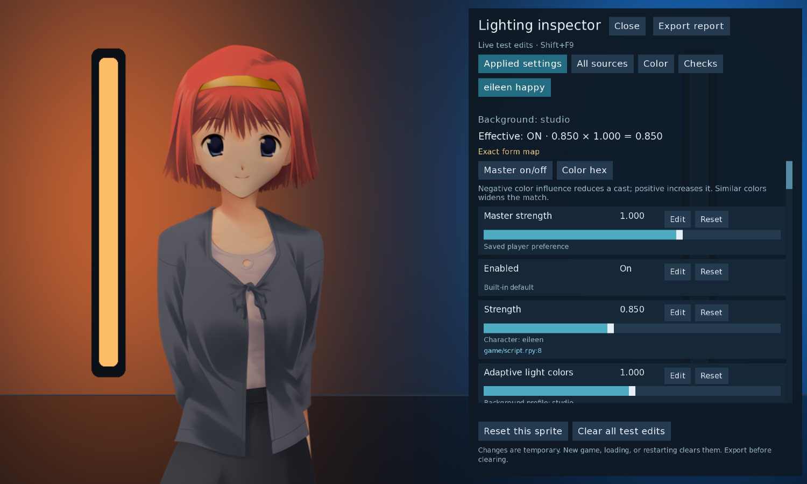

# SceneLight in pictures

## Warm and cool light

The same sprite and placement, without and with SceneLight:

[Watch Eileen move between the lights](media/moving-light.mp4).

## A sunlit forest

Compare with the original sprite

## Moving backgrounds

[Watch the waterfall video](media/waterfall-example.mp4).

## Shared lighting

Groups share a lighting position and settings. [Add a group](AUTHOR_QUICKSTART.md#light-separate-sprites-together).

## Glow and reviewed exports

## In-game adjustments

Press **Shift+F9** to inspect and temporarily adjust the current scene.

The forest, waterfall and motion examples were rendered with earlier versions;
appearance can vary with settings and version. [Artwork credits and sources](media/CREDITS.md).

[Back to SceneLight](../README.md) · [Preview guide](PREVIEW_WORKSPACE.md)
