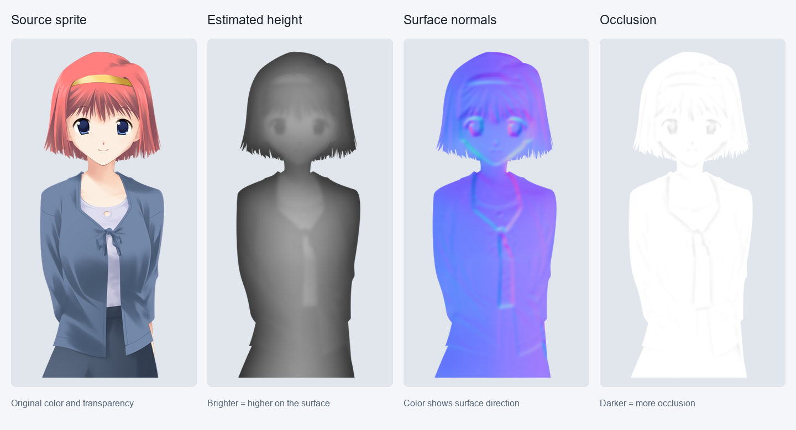
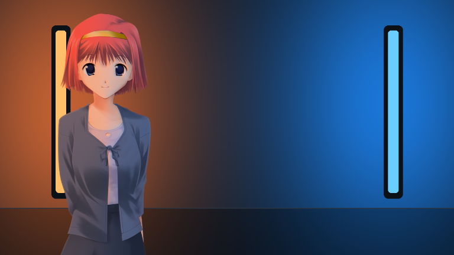

# How SceneLight lights a sprite

SceneLight combines two things: an estimate of the light in the background and
an estimate of the sprite’s surface. Neither requires painting a new version of
the character for each scene.

The example uses the same source image, position and scale on both sides. The
warm and blue light come from the two lamps in the generated background. These
are actual Preview renders with the default lighting settings.

## The character maps

**Height** is a shallow estimate made from the transparent outline and the
image’s existing shading. The broad shape inferred from the outline is smoothed
separately from the finer painted relief. This removes artificial creases while
keeping detail in the surface directions.
Brighter values in the diagram mean higher parts of that estimated surface.

**Normals** describe the direction the surface faces at each point. Their colors
encode that direction, rather than a visible tint. The renderer uses them to
decide how strongly a light reaches each part of the sprite.

**Occlusion** estimates recesses in the height map that receive less light. The
display here is inverted so white means open and darker means more occlusion.
This character’s smoothed surface has very little occlusion, so the panel is
nearly white.

The renderer also uses edge, grain and average surface-response data. These
help blend the silhouette into the scene and control how strongly the generated
shape affects the image. The original color image and alpha channel are kept.

These maps describe a 2D estimate. They do not reveal hidden geometry, identify
materials perfectly or replace a model made by an artist. Strong painted
highlights and unusual silhouettes can still need calibration.

## The background

SceneLight measures brightness, contrast, environmental color and visible light
sources. It samples light around the character’s screen position, including
directional sources and softer environmental light. When distinct colored
sources are present, their colors can reach different areas of the sprite.

The shader combines that information with the character maps each time Ren’Py
draws the sprite. Normal `show`, `hide`, ATL movement and transitions continue to
control the character.

In this example only the character moves. The background and lights stay fixed.
The animation uses lossless WebP to preserve the rendered colors. Its playback
speed is for demonstration, not a frame-rate benchmark.

## What gets prepared

Character maps are reusable across scenes. Supported movies also get a lossless
lighting cache for every video frame during preparation. Playback reads those
results instead of analyzing the movie again. Code-generated or visually
transformed backgrounds can use live analysis when cached lighting would not
match the visible scene.

Preparation trades time and disk space for less repeated work during playback.
It does not make graphics rendering free: resolution, visible characters and
live background effects still affect performance.

## Try your own scene

Open **Preview & Calibrator**, load a background and sprite, then move the sprite
around. Compare the original and relit views before changing individual controls.
Start with lighting strength, then adjust exposure or the colored-light controls
if the scene needs them. [The author API](MOD_AUTHOR_API.md) provides the same
controls in a Ren’Py project.

The example artwork, licenses and generation details are in
[the image credits](media/CREDITS.md).
